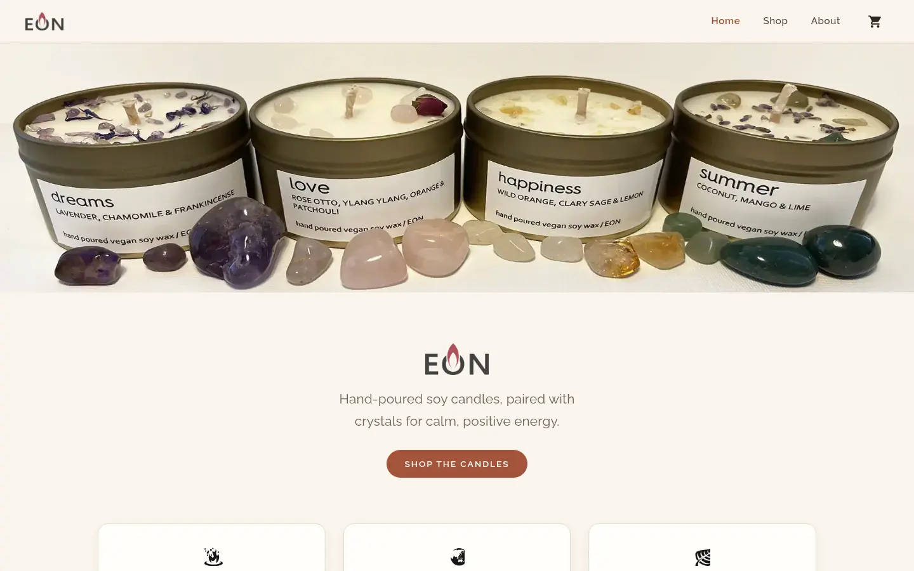
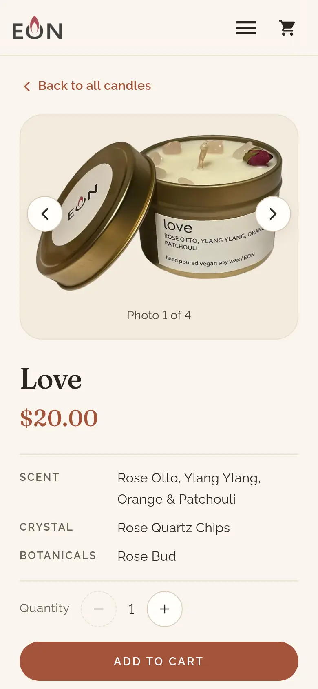
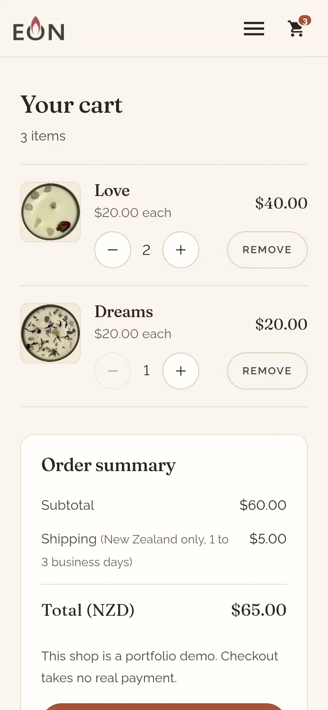

# Eon

Brand and shop site for Eon, a New Zealand candle label, built with Next.js and Stripe Checkout.

My own project: built in 2021 and 2022, modernised in 2026.

**Live site:** [eon-ht82.vercel.app](https://eon-ht82.vercel.app/)



<p>
  
  
</p>

## About

Eon's candles are hand-poured in vegan soy wax, each paired with crystal chips and botanicals. The site has a home page, a shop page, a page for each of the four candles (love, happiness, dreams and summer), an about page, and a cart with a checkout that is priced on the server.

The live site is meant to run as a portfolio demo that takes no payment: with no `STRIPE_SECRET_KEY` set, checkout shows an order summary. What the deployed site actually does depends on the Vercel project's environment variables; see [Before you deploy](#before-you-deploy).

First built from December 2021 to February 2022 and modernised in 2026: a small design system (cream, terracotta and sage, Fraunces and Raleway), Next.js 16 and React 19, a demo-mode checkout priced on the server, keyboard and screen-reader fixes, and unit, API and end-to-end tests.

## Features

- **One product route** (`pages/shop/[slug].js`) builds a static page for each candle from the catalogue. Thumbnails choose the main photo, the photo opens a full-screen lightbox built on the native `<dialog>` element (arrow keys, Escape, focus returns to the photo), and Add to cart confirms each add in a live region. The quantity stepper goes from 1 to 10.
- **A cart kept in `localStorage`** through a pure reducer (`lib/cart.js`), with prices in cents from one catalogue (`data/candles.js`). It shows line totals, NZ shipping and the total, has a stepper and a Remove button on each line, survives a reload and stays in sync across tabs. Carts saved by the first version are migrated, and a corrupt saved cart loads as an empty one.
- **A checkout API route** (`pages/api/checkout_sessions.js`) that validates the cart and prices it on the server. It runs in demo mode unless a Stripe key is set; see [How checkout works](#how-checkout-works).
- **An order page** (`/success`) that shows the demo order summary straight after a demo checkout. After a Stripe checkout it asks the server to check the session with Stripe, and thanks the shopper and empties the cart only for a paid session. A direct visit or a made-up session id leaves the cart alone.
- **Navigation** with a skip link, a mobile menu that reports its state and closes on Escape, an outside tap, Back or a link, and one cart link named with the item count.
- **Accessibility checks** with axe-core (WCAG 2.2 A and AA rules plus best practice) on every page and interactive state at 390 and 1440 px, 44 px touch targets, a visible focus ring, reduced motion, no sideways scrolling at 320 px and no clipped text at 200% text size.
- **Security headers** in `next.config.js`: a Content-Security-Policy that allows only the site's own scripts, fonts and connections, plus HSTS, `X-Content-Type-Options`, `X-Frame-Options`, `Referrer-Policy` and `Permissions-Policy`.
- **Page metadata from one site URL**: titles, descriptions, canonical links and the social card. `robots.txt` and `sitemap.xml` are written at build, and the cart, order and error pages are marked `noindex`.
- **No third-party requests**: fonts are self-hosted and there are no analytics or Stripe scripts in the browser.

## How checkout works

1. The cart sends only candle slugs and quantities to `POST /api/checkout_sessions`.
2. Next's body parser answers first, in plain text: `413` for a body over 8 kB and `400` for malformed JSON. The server then checks the request: JSON only (`415` otherwise), known candles, whole quantities from 1 to 10, each candle once and no other fields (`400` with a JSON `error` otherwise). It prices each line, shipping and the total from the catalogue. Nothing the browser sends can change a price.
3. The mode is decided on every request:
   - **No `STRIPE_SECRET_KEY` (the default, and how the live demo is meant to run): demo mode.** The API returns the order summary, the browser shows it on `/success` and empties the cart, and no payment is taken.
   - **A Stripe test key** (`sk_test_` or `rk_test_`) creates a Stripe Checkout session in test mode: prices in NZD built on the server, New Zealand addresses only and a flat NZ$5 shipping rate (1 to 3 business days). The browser goes to the URL Stripe returns, and only if it is on `checkout.stripe.com`.
   - **A live key** takes real payments only when `EON_ALLOW_LIVE_PAYMENTS=true` is also set. Without it the shop stays in demo mode and logs a warning once per server instance, never including the key.
   - If Stripe rejects the key, checkout falls back to demo mode. Any other Stripe error returns a plain `502` with no details from Stripe.
4. Stripe's return URLs come from an allow-list: the site URL, this deployment's Vercel URLs, and `localhost` or `127.0.0.1` outside production. The request's `Origin` header is never used, so nobody can point the shop's Stripe page at another site.
5. Back from Stripe, the order page calls `GET /api/checkout_sessions/:id` with the `session_id` Stripe added to the URL. The server checks the id's shape and that it matches the key's mode (test or live), retrieves the session from Stripe and answers `paid` with the total, or `unpaid`, never the shopper's details. An id Stripe doesn't know is a `404` and any other Stripe error a `502`. In demo mode every id is a `404`, without contacting Stripe. The page thanks the shopper and empties the cart only for a paid session.

## Tech stack

- Next.js 16 (pages router, built with webpack) and React 19
- CSS Modules, with shared design tokens as CSS custom properties in `styles/globals.css`, and Fraunces and Raleway self-hosted through `next/font/local`
- Stripe's Node SDK on the server; the browser needs no Stripe key or script
- react-icons for the interface icons
- Vitest, Testing Library and jsdom for unit, API and component tests; Playwright and axe-core for end-to-end, accessibility and performance tests
- ESLint 9 with jsx-a11y, Prettier, and a TypeScript check of the checkout code's JSDoc types against the Stripe SDK
- Node 24 (pinned in `package.json` and `.nvmrc`), deployed on Vercel

## Running locally

You need Node 24 (`nvm use` reads `.nvmrc`).

```bash
npm ci
cp .env.example .env.local   # optional
npm run dev
```

Then open http://localhost:3000. Checkout works with no keys: it runs in demo mode. To try a Stripe test-mode hand-off, set `STRIPE_SECRET_KEY` in `.env.local` to a test key from your own Stripe account.

### Environment variables

All are optional, and the build needs none. `.env.example` describes each one.

| Name                      | Default                                                     | What it does                                                                                               |
| ------------------------- | ----------------------------------------------------------- | ---------------------------------------------------------------------------------------------------------- |
| `STRIPE_SECRET_KEY`       | empty: demo mode                                            | A test key turns on the Stripe test-mode hand-off. A live key needs `EON_ALLOW_LIVE_PAYMENTS` too.         |
| `EON_ALLOW_LIVE_PAYMENTS` | empty                                                       | `true` lets a live key take real payments.                                                                 |
| `NEXT_PUBLIC_SITE_URL`    | Vercel's production URL, then `https://eon-ht82.vercel.app` | Canonical links, the sitemap and Stripe's return URLs.                                                     |
| `EON_STRIPE_API_BASE`     | empty                                                       | Tests only: sends Stripe API calls to a local stub. Ignored unless the host is `localhost` or `127.0.0.1`. |

The API routes read the Stripe settings on every request. The cart page reads them at build time to choose its wording, and `NEXT_PUBLIC_SITE_URL` is fixed at build time too, so set them before `npm run build`.

### Before you deploy

The repo can't see the Vercel project's environment variables. Before a production deploy, check them in the Vercel dashboard (Settings, Environment Variables). For the demo, `STRIPE_SECRET_KEY`, `EON_ALLOW_LIVE_PAYMENTS` and `EON_STRIPE_API_BASE` should all be unset; the table above and [How checkout works](#how-checkout-works) say what each one does. Redeploy after changing any of them, because the cart page reads them at build time. `NEXT_PUBLIC_STRIPE_PUBLISHABLE_KEY` is no longer read and can be deleted if it is still set.

### Scripts

- `npm run dev`: development server
- `npm run build` and `npm run start`: production build and server. The build writes `robots.txt` and `sitemap.xml` first.
- `npm test`: unit, API and component tests (Vitest). A guard fails any test that opens a connection to anything other than localhost.
- `npm run test:coverage`: the same tests, with at least 90% line coverage required for `lib/` and the API routes
- `npm run test:e2e`: end-to-end tests (Playwright). It builds the site, starts it on `127.0.0.1:7301` in demo mode, and runs the shopping journey, cart, checkout, gallery, navigation, accessibility and SEO specs at 390 and 1440 px, and the performance budgets once on an emulated phone. A second server on port 7305, with a local Stripe stub on 7309, covers Stripe test mode (the hand-off, the return to the order page, a forged session id and a Stripe outage), so nothing calls Stripe. Set `CHROME_PATH` to use an installed Chrome, or run `npx playwright install chromium` first.
- `npm run lint`, `npm run typecheck`, `npm run format` and `npm run format:check`
- `npm run check`: lint, type check, format check, tests with coverage and a production build

`.github/workflows/ci.yml` runs `npm run check` and then the end-to-end tests on Node 24, in demo mode with no secrets.

## Project structure

```
pages/          Home, shop, about, cart, success, 404 and 500 pages
pages/shop/     [slug].js: one statically generated page per candle
pages/api/      checkout_sessions.js: validates the cart, then demo or Stripe
                checkout_sessions/[id].js: checks a Stripe session for the order page
components/     Nav bar, footer, product card and gallery, lightbox, cart controls, SEO tags
data/           The candle catalogue, product copy and the photo lists for each candle
hooks/          The cart hook, backed by a small store in lib/
lib/            Cart reducer and store, checkout, checkout mode, money, site URL and fonts
styles/         Global design tokens, per-page CSS Modules and the font files
assets/         Product photos, the logo and icons, imported by the code
public/         The favicon, the home-screen icon and the social card image
scripts/        Writes robots.txt and sitemap.xml at build
tests/          Vitest unit, API and component tests, and test helpers
e2e/            Playwright end-to-end, accessibility and performance tests
docs/           README screenshots
```

## Decisions and trade-offs

- **A cart in `localStorage`, not on a server.** Four candles and no accounts don't need a database, and the server prices every checkout from the catalogue, so editing the saved cart can't change a price. The cost: a cart doesn't follow a shopper to another device.
- **Stripe's hosted Checkout, not card fields on the site.** Card details never touch this site, and the browser loads no Stripe script. The cost: less control over how the payment page looks.
- **A static catalogue in `data/candles.js`, not a CMS.** Every page is prerendered and needs no database. The cost: a new candle or price means a code change and a deploy.
- **Demo mode by default.** The live demo works end to end without taking money, and a live key set by mistake can't switch real payments on by itself.
- **The order page checks each Stripe session as it loads, with no order records.** A typed-in session id can't fake a thank-you or empty a cart, and there is still no database. The cost: the shop keeps no list of paid orders; that lives in the Stripe dashboard.
- **What would come next:** a Stripe webhook to record paid orders, and stock levels if the range grows.

## Credits

- The three home-page pillar icons are from [game-icons.net](https://game-icons.net) under [CC BY 3.0](https://creativecommons.org/licenses/by/3.0/), cropped: burning embers and linden leaf by [Lorc](https://lorcblog.blogspot.com), and earth Asia and Oceania by [Delapouite](https://delapouite.com).
- The Facebook icon is from Font Awesome Free (CC BY 4.0). The other interface icons are Ionicons and Ant Design Icons (MIT). All come through react-icons.
- Fraunces and Raleway are under the SIL Open Font License 1.1 (`styles/fonts/OFL.txt`).

## Author

Built by Daniel Olliver. More of my work: [danielolliver.com/dev](https://danielolliver.com/dev/).

I also run [Olliver Web](https://olliverweb.co.nz), my web design and development service in Auckland for small-business websites, online stores and web apps.

Ben Jones contributed early responsive layout work between December 2021 and January 2022.
